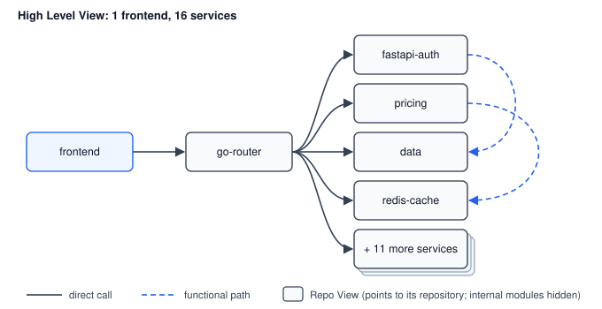

# Spatial Context: Why Visual Views Solve the Documentation Problem in AI Systems

**Tony Turner**
SpatialThinking.ai
January 2025

---

## Abstract

As AI-assisted development scales, a critical failure pattern emerges: error rates increase proportionally with application complexity. This paper argues that the root cause is not AI capability, but context architecture. Documentation - the traditional solution to knowledge transfer - fails because it is treated as a writing discipline rather than a structural byproduct.

We propose Spatial Context Theory: that hierarchical visual views, when properly structured, eliminate the documentation problem entirely by making documentation a generated output rather than a maintained input. This approach simultaneously solves four interconnected problems in AI-assisted development: the black box problem, context noise, LLM guessing behaviour, and error rate scaling.

---

## 1. Introduction

The documentation problem is not new. What is new is the cost of leaving it unsolved.

In traditional software development, poor documentation slowed onboarding and increased tribal knowledge dependency. These were friction costs - painful but survivable.

In AI-assisted development, poor documentation is catastrophic. AI systems cannot access knowledge stored in developers' heads. They cannot infer intent from four-year-old TODO comments. When context is missing, they guess. When they guess at scale, error rates compound.

The industry response has been to pass more context to AI systems. This creates a secondary problem: noise. Too much context is as damaging as too little. Both trigger the same failure mode - guessing.

This paper proposes that the solution is not better documentation practices, but better documentation architecture. Specifically: visual views that make documentation a structural byproduct rather than a separate discipline.

---

## 2. The Four Problems

### 2.1 The Black Box Problem

AI-assisted development creates an observability gap. Humans need to understand what AI is building. AI needs to understand what humans intend. Current solutions address one side or the other. Both must be solved simultaneously, or neither is solved at all.

### 2.2 The Guessing Problem

Large Language Models exhibit a consistent failure pattern: when context is insufficient or ambiguous, they generate plausible-sounding outputs rather than requesting clarification. In conversational use, this is a minor irritant. In automated systems operating at scale, this behaviour compounds into systemic failure.

### 2.3 The Context Problem

Context management presents a paradox. Insufficient context triggers guessing behaviour. Excessive context - noise - also triggers guessing behaviour, as the signal-to-noise ratio degrades below usable thresholds. The solution space is narrow: precisely the right context, at precisely the right moment.

### 2.4 The Scaling Problem

In AI-assisted development, error rates do not remain constant as complexity increases. They scale with complexity. Each additional component, integration, or abstraction layer increases the probability of context failure, which increases guessing behaviour, which increases error rates.

The goal is not to reduce error rates at a fixed complexity level. The goal is to keep error rates flat as complexity increases.

---

## 3. Why Documentation Fails

Documentation fails for a structural reason, not a discipline reason.

The standard model treats documentation as a parallel artifact: code is written, then documentation is written about the code. This creates three failure modes:

1. **Temporal drift**: Documentation and code diverge over time as one is updated without the other.

2. **Context loss**: The author's understanding at write-time is not captured - only their description of outputs.

3. **Maintenance burden**: Documentation requires active effort to maintain, competing with delivery pressure. Delivery pressure always wins.

The result is predictable: documentation becomes a TODO item, last edited years ago, containing information that is incomplete at best and misleading at worst.

Asking developers to document better is asking them to fight incentive structures. It does not work.

---

## 4. Spatial Context Theory

We propose an alternative model: documentation as a generated output of visual structure, not a written input.

### 4.1 Core Principle

If a system's structure is represented visually, and that visual representation is hierarchical, then documentation can be generated from the structure rather than written alongside it.

The visual representation becomes the source of truth. Documentation is derived, not authored.

### 4.2 The View Hierarchy

Spatial Context Theory proposes a four-level hierarchy. Consider a concrete example: building a platform with 1 frontend and 16 microservices.

**Level 1: High Level View**
Create a High Level View. Then create 17 Repo Views - one for each component: frontend, auth, router, pricing, redis-cache, data, and so on. Each Repo View points to its repository. Import all 17 into the High Level View, but without their internal modules - just as boxes representing each service.

Now draw connections: frontend → router → downstream services. Use solid lines for direct calls, dashed lines for functional paths. Name modules to embed context: `fastapi-auth`, `go-router`, `redis-cache`. Humans now know what we're building. So does AI.

**Level 2: Sub-views**
Open the frontend View and add all its pages as modules. Create a `frontend-backend` sub-view - this is not a High Level View, not a Repo View - and import all the service views with their modules and connections visible. The sub-view now shows all services, all functional and non-functional paths, all relationships.

**Level 3: Features**
Here is where it becomes powerful. You need a feature or a bug fix. Lasso the relevant modules, or shift-click to select them. A context panel appears. Create a ticket or create a feature from the selected modules. The system exports only the relevant context for that feature - not the entire codebase.

Over time, each module accumulates pointers to files in the source code. The View becomes richer without additional documentation effort.

**Level 4: Feature Documentation**
Generated by AI from the View structure. The feature's position in the hierarchy, its parent views, its connections, its selected modules - all of this context flows into AI-generated documentation. The documentation stays current because the View is the source of truth. When the View changes, the documentation regenerates. There is no separate artifact to maintain.

### 4.3 Big Picture, Little Picture

The hierarchy reduces to a simple principle: AI needs two things.

**Big Picture**: The High Level View. Flowchart boxes showing what we're building - the architecture, the services, the connections. This is the "what are we building" context.

**Little Picture**: The Feature. The specific modules selected for this task, their relationships, their source file pointers. A feature might be new functionality, an amendment to existing behaviour, or a bug fix on a previously created feature. The View handles all three - the same lasso, the same context export, the same workflow.

Pass both to AI. The Big Picture prevents hallucination about system architecture. The Little Picture scopes the work precisely. AI does not guess because both pictures are visually defined, not inferred from scattered documentation.

### 4.4 Why This Works

The hierarchy solves all four problems simultaneously:

- **Black Box Problem**: The visual structure is observable by both humans and AI. There is no hidden state.

- **Guessing Problem**: Context is structurally defined. AI does not need to infer - the view tells it what exists and what is intended.

- **Context Problem**: Views scope context precisely. The relevant sub-view provides exactly the context needed - no more, no less.

- **Scaling Problem**: As complexity increases, it is represented by additional views and sub-views. The structure scales; the error rate does not.

---

## 5. Documentation as Byproduct

In the Spatial Context model, documentation is generated, not hand-written.

When a feature is defined within a sub-view, the system has access to:

- The feature's position in the hierarchy
- Its parent view and sibling features
- Its defined inputs and outputs
- Its relationships to other features
- The intent captured in the visual structure

From this, documentation is generated automatically. It stays current because it is derived from the structure, which removes the drift and most of the maintenance burden.

The documentation problem is not solved by better discipline. It is solved by eliminating the need for discipline entirely.

---

## 6. Implications for AI-Assisted Development

Spatial Context Theory has direct implications for the current generation of AI coding assistants and automation tools.

### 6.1 Context Windows

Current AI systems are limited by context window size. Spatial views provide natural chunking - pass the relevant view, not the entire codebase.

### 6.2 Agent Architectures

Multi-agent systems require shared understanding. Visual views provide a common reference that all agents can read and reason about.

### 6.3 Human-AI Collaboration

The view becomes the collaboration surface. Humans express intent visually. AI executes against that intent. Both observe the same structure.

Humans reason over the View: boxes, lines and names they can see. AI reasons over the same View as a graph: modules are nodes, connections are edges, and names and file pointers are properties. Most diagrams are already stored as structured data behind the picture, so nothing has to be translated. The picture and the graph are one thing, read two ways.

---

## 7. What It Solves

Used as the one place a team draws and documents its systems, the same Views give:

- **One shared source of truth.** Logic, design, diagrams and docs live in the same shared Views.
- **A source of truth shared by AI and humans.** People and AI agents read and work from the same structure, so intent and output come from one place.
- **Onboarding.** A new starter follows the Views from the High Level View down: what the system is, how it connects, where each feature sits, then into the code.
- **Lower token cost.** AI is passed the relevant View, not the whole codebase or document set, so each task needs fewer tokens.
- **Long context for AI.** The Views hold the context across sessions and tasks, so AI keeps the long picture without needing an ever-larger context window.

---

## 8. Conclusion

The documentation problem has persisted for decades because it has been framed as a discipline problem. It is not. It is an architecture problem.

When documentation is treated as a parallel artifact, it will always degrade. When documentation is generated from structure, it stays tied to the current state.

Spatial Context Theory proposes that visual, hierarchical views are the correct architecture. They solve documentation as a byproduct while simultaneously addressing the black box, guessing, context, and scaling problems that limit AI-assisted development.

---

## About the Author

Tony Turner is the founder of Spatial Thinking, a research practice exploring how visual and spatial approaches solve fundamental problems in AI systems. His background includes building an ISP from a garage to £6M ARR (exited 2007), serving at Napster as VP Architecture and then VP Engineering (56 engineers), and over 25 years of production systems across telecommunications, manufacturing and software architecture.

---

## Citation

Turner, T. (2025). Spatial Context: Why Visual Views Solve the Documentation Problem in AI Systems. SpatialThinking.ai.

---

## License

This work is licensed under the MIT License. See [LICENSE](LICENSE) for details.
